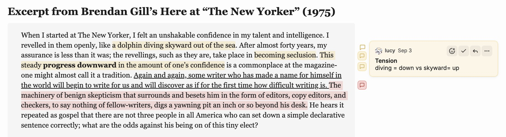
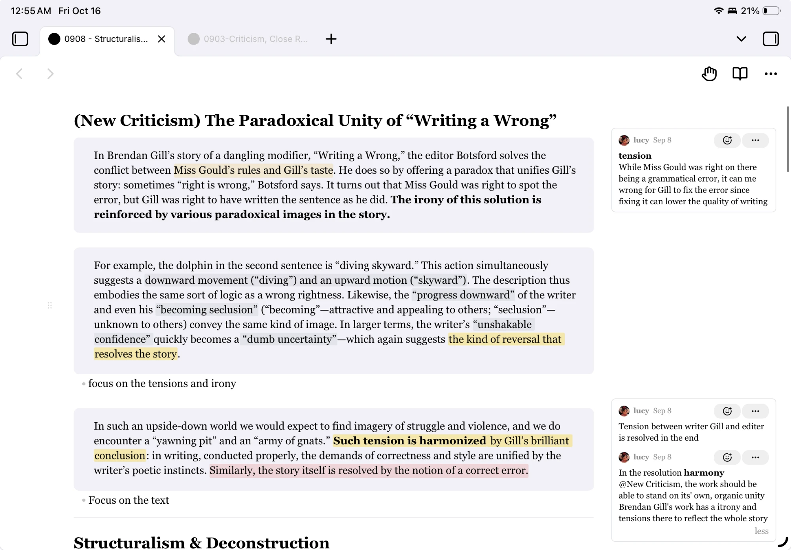
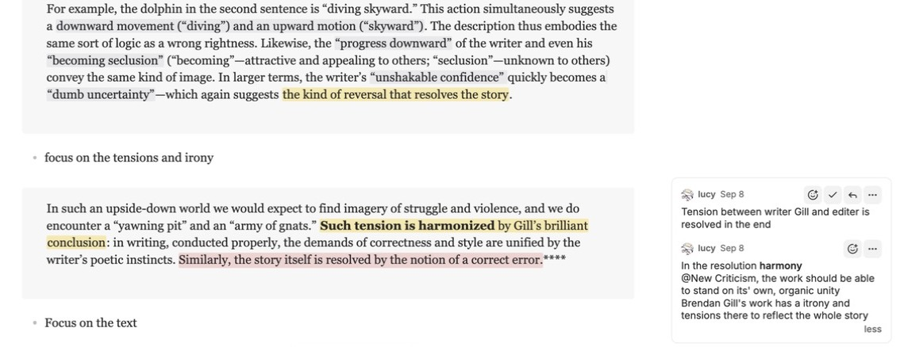

# Notion-style Comments

> This is a fork of [kylemcd/obsidian-document-comments](https://github.com/kylemcd/obsidian-document-comments) (**Document Comments**) by **Kyle McDonald**. All credit for the original plugin goes to the original author. This fork adds the features listed below. The original work is used under the MIT License; see [LICENSE](LICENSE).

Notion-style Comments adds inline comments to Obsidian notes. It shows each comment as a card beside the text on desktop and iPad.

[Install it from the Obsidian community plugin directory](https://obsidian.md/plugins?id=notion-style-comments).

If you like it, [](https://buymeacoffee.com/jiwooroh)

The plugin stores each comment inside its Markdown file as an HTML comment. Other editors, version control tools, and agents can read the comment.

## Check this out!

For more Notion-style editing, check out [Notion Selection Toolbar](https://obsidian.md/plugins?id=notion-selection-toolbar), another plugin of mine.


## What this fork adds

### Text formatting toolbar in comments

Select text while you write or edit a comment, and a small toolbar appears above the comment box:

- **B** / *I* / <u>U</u> / ~~S~~: bold, italic, underline, strikethrough
- Text color
- Highlight color


### Highlight colors

Choose how commented text is marked in your notes.

- **Color scheme**: **Notion** (soft, solid fills) or **Apple** (bright Apple-style colors with translucent fills). Both have separate light and dark palettes and also set the text colors in the comment toolbar.
- **Highlight color**: your theme's highlight color, or one of the scheme's 9 colors (yellow, green, blue, purple, pink, red, orange, brown, gray).
- **Highlight intensity**: 0% (the default) is Notion's exact color. Raise it to make every highlight bolder.
- **Custom colors**: pick your own hex value for each color, separately for light and dark themes. Each picker shows the default until you change it; ↺ resets it.


<details>
<summary>Color codes for both schemes</summary>

**Text** colors the underline, hover tint, and colored comment text. **Highlight** is the fill behind commented text (at 0% intensity). Apple's highlights are translucent: the last two digits are opacity (`26` = 15%, `33` = 20%). For text + background, use a color's text value on its own highlight, for example `#DE2E21` on `#DE2E2126`.

##### Notion

| Color | Text: light | Text: dark | Highlight: light | Highlight: dark |
|---|---|---|---|---|
| Red | `#C4554D` | `#CF5D57` | `#FAECEC` | `#4D302B` |
| Orange | `#CC782F` | `#BD8052` | `#F8ECDF` | `#573C27` |
| Yellow | `#C29343` | `#C29A56` | `#FAF3DE` | `#53442C` |
| Green | `#548164` | `#659C75` | `#EEF3EC` | `#2A3C31` |
| Blue | `#487CA5` | `#6786C4` | `#E9F3F7` | `#1E394C` |
| Purple | `#8A67AB` | `#956ACD` | `#F6F3F9` | `#3A2E47` |
| Pink | `#B35388` | `#C25F94` | `#FDE8F1` | `#492E3B` |
| Gray | `#787774` | `#9B9B9B` | `#F1F1EF` | `#2F2F2F` |
| Brown | `#976D57` | `#B28773` | `#F3EEEE` | `#46332A` |
| Default | theme text | theme text | theme highlight | theme highlight |

##### Apple

| Color | Text: light | Text: dark | Highlight: light | Highlight: dark |
|---|---|---|---|---|
| Red | `#DE2E21` | `#EC5F55` | `#DE2E2126` | `#EC5F5526` |
| Orange | `#F09343` | `#F09748` | `#F0934326` | `#F0974826` |
| Yellow | `#F4C242` | `#F6CE55` | `#F4C24233` | `#F6CE5526` |
| Green | `#30CF6A` | `#51DB84` | `#30CF6A26` | `#51DB8426` |
| Blue | `#3869F0` | `#598BF8` | `#3869F026` | `#598BF826` |
| Purple | `#BB3ED9` | `#CA43EA` | `#BB3ED926` | `#CA43EA26` |
| Pink | `#ED358E` | `#F75FA8` | `#ED358E26` | `#F75FA826` |
| Gray | `#9898A0` | `#A0A0A7` | `#9898A026` | `#A0A0A726` |
| Brown | `#B38C65` | `#B8946F` | `#B38C6526` | `#B8946F26` |
| Default | theme text | theme text | theme highlight | theme highlight |

</details>

### Underline style and per-comment overrides

- **Annotation style**: mark commented text with a highlight only, an underline only, or both.
- Use a comment's **⋯** menu to change the color or style of that single comment.


### Comment from a selection toolbar

Pair this fork with [Notion Selection Toolbar](https://github.com/jiwooroh/notion-selection-toolbar), another plugin of mine. Select text in a note and choose **Comment** from its floating toolbar to start a comment.


### Card views

Switch how comment cards look from **💬** in the status bar at the bottom of Obsidian, or in settings (**Comment card view**):

- **Default**: full cards with author, date, buttons, and reactions.
- **Compact**: only the comment text; click a card to see its buttons.
- **PDF style**: like a PDF reader. Each comment is a small note icon in its color right next to the text. Hover it to see the first line, and click the icon or the highlight to open the card beside it. Press Escape, click elsewhere, or click the icon again to close it.



**Card color indicator** (settings) shows each card's highlight color as a line on the left, a colored card, a dot, or nothing, so you can tell which card belongs to which text. In the sidebar, pick one or more colors under Open / Resolved / All to see only those comments.

### Comments in PDF export

When you export a note to PDF, each commented passage is highlighted with a footnote number, and its comment (with replies) is printed beside it in a right-hand margin column. Turn it off with **Show comments in PDF export** in settings, or run **Toggle comments in PDF export** from the command palette. Resolved comments are included only when **Show resolved comments** is on.

### Narrow window layout

On desktop, when the window is too narrow for the margin, comment cards hide and appear when you hover over the highlighted text, so the note keeps its full width. (iPad always keeps the column; see below.)


### Profile photo

In settings, set **Profile photo** to an image from your vault (**Choose…**) or an image link. It shows as a small round photo next to your name on your own comments and replies. Turn off **Show my profile** to hide your name and photo on your comments.

### Hide author names

Turn off **Show author names** in settings to hide who wrote each comment and reply, on comment cards and in highlight hover previews.

### Long comments

Long comments show in full when there's room. A comment folds to a "more" preview only when it would run into the next card, or when it's taller than the window (then it offers **Open in sidebar →**). Use **less** / **more** to fold or unfold one yourself; your choice stays until you click the other.

### iPad support



- iPad shows comment cards in the margin, like desktop. When a note has comments, the text narrows so the column always fits beside it.
- Cards are compact on iPad: a 270px column, tighter spacing, and smaller buttons, sitting evenly between the text and the screen edge.
- Each comment shows just **React** and **⋯**. **Resolve** is in the **⋯** menu; tap the card to reply.

Phones show highlights only, and you read and add comments in the sidebar and a pop-up.

### Reliable Reading view



Comments show in Reading view even when the commented text has formatting in it (bold, italic, links, wikilinks, `==highlights==`), crosses a formatting boundary, runs across blockquote or list lines, or overlaps another comment. A comment that lost one of its markers (for example after an edit outside the plugin) is found by the quote saved with it.

### Scrolling

In the editor, comment cards scroll exactly with the text.

### Smaller touches

- Comment boxes grow as you type.
- Comments use the interface font, even in notes with their own font (a serif cssclass, for example).
- A comment on bold or other formatting at the start of a line no longer breaks that line's formatting.
- Click your own comment text to edit it.

## Original features

### Comments and storage

- Store comments inside Markdown files without a separate database.
- Add comments to prose, inline code, tables, and selected lines in fenced code blocks.
- Save an empty comment and highlight its selected text.
- Reply (click the card), resolve, reopen, edit, delete, or react to a comment.
- Write Markdown in comments, including links, lists, bold text, and code spans.
- Use the same notes on desktop and mobile.

### Views and controls

- Show comment cards in Live Preview, Source view, and Reading view.
- Open long comments in the sidebar.
- Filter the sidebar by open, resolved, or all comments.
- Hide all comments or hide resolved comments.

## Comment format

The plugin uses an anchor pair and a comment block:

```markdown
We should <!--c:k3f9-->ship on Friday<!--/c:k3f9--> regardless of the QA timeline.
<!--co:k3f9 by:kyle at:2026-06-17T10:00:00.000Z status:open quote:"ship on Friday"
kyle (2026-06-17T10:00:00.000Z): I thought we agreed Thursday?
sam (2026-06-17T10:05:00.000Z): Thursday is better for QA.
-->
```

The `<!--c:ID-->` and `<!--/c:ID-->` markers identify the selected text. The matching `<!--co:ID ...-->` block stores the comment thread.

Markdown renderers hide these HTML comments. Tools that read the source file can find each comment and its selected text.

Deleting a comment removes only its markers and its comment block. The selected text, and the line breaks around it, stay exactly as they were.

Comments on fenced code blocks use the same format. The comment block also stores the selected line range and exact code text.

A comment's color or style override (set from its **⋯** menu) is stored in the same header, for example `color:blue style:underline`.

An empty comment uses the same markers. Its comment block has no thread lines:

```markdown
We should <!--c:h7k2-->ship on Friday<!--/c:h7k2--> regardless of the QA timeline.
<!--co:h7k2 by:kyle at:2026-06-17T10:00:00.000Z status:open quote:"ship on Friday"
-->
```

## Install

Notion-style Comments requires Obsidian 1.7.2 or newer. It supports desktop and mobile.

### Community plugins

Install it from Obsidian:

1. Open **Settings → Community plugins**.
2. Select **Browse**.
3. Search for **Notion-style Comments**.
4. Select **Install**.
5. Select **Enable**.

### BRAT

Use BRAT to install a pre-release build:

1. Install **BRAT** from Community plugins.
2. Enable **BRAT**.
3. Run **BRAT: Add a beta plugin for testing**.
4. Enter `jiwooroh/obsidian-document-comments`.
5. Enable **Notion-style Comments** in Community plugins.

BRAT installs the latest GitHub release and checks for updates.

### Manual install

1. Download `main.js`, `manifest.json`, and `styles.css` from the [latest release](https://github.com/jiwooroh/obsidian-document-comments/releases).
2. Copy the files to `<your-vault>/.obsidian/plugins/notion-style-comments/`.
3. Restart or reload Obsidian.
4. Enable **Notion-style Comments** in Community plugins.

Create the `notion-style-comments` directory if it does not exist.

### Build from source

```bash
git clone https://github.com/jiwooroh/obsidian-document-comments
cd obsidian-document-comments
npm install
npm run build
```

Copy or link `main.js`, `manifest.json`, and `styles.css` to `<your-vault>/.obsidian/plugins/notion-style-comments/`.

Then enable **Notion-style Comments** in Community plugins.

## Use the plugin

### Add a comment in an editing view

1. Select text or one or more lines in a fenced code block.
2. Run **Add comment** from the command palette or your configured editor menu.
3. Write the comment in the margin composer.
4. Press Enter to save the comment.

Press Shift+Enter to add a line break. On a phone, use the dialog to save the comment.

### Add an empty comment

Notion-style Comments disables empty comments by default.

1. Open **Settings → Notion-style Comments**.
2. Enable **Allow empty comments**.
3. Select text and run **Add comment**.
4. Leave the comment field empty.
5. Press Enter on desktop or tablet, or select **Empty comment** on a phone.

The plugin highlights the selected text and shows a comment card. The card shows **Empty** until you add text.

Select **Empty** to add the first comment text. Use the card menu to delete the empty comment.

You can also select all the highlighted text and run **Add comment** again. Write text to add the first comment. Submit the empty field to delete it.

When **Allow empty comments** is off, an empty field closes without a change.
Existing empty comments remain available. You can add text or delete them.

### Add the command to the right-click menu

The optional [Commander plugin](https://community.obsidian.md/plugins/cmdr) can add commands to the editor menu.

#### Install Commander

1. Install **Commander**.
2. Enable **Commander**.

#### Configure the editor menu

1. Open **Settings → Commander**.
2. Select **Editor Menu**.
3. Select **Add command**.
4. Search for `Notion-style Comments: Add comment`.
5. Select the command.
6. Choose an icon.

The command now appears at the bottom of the editor right-click menu. Select text before you use it.

### Add a comment in Reading view

1. Select text in the active note.
2. Run **Add comment in reading view**.
3. Write the comment.
4. Save the comment.

The Reading view command cannot add comments to embedded content.

### Manage a comment

Select a card to open its reply field. Each entry has **react**, **resolve**, and **reply** buttons, plus a **⋯** menu to change the comment's color or style, or delete it. On iPad, only **react** and **⋯** are shown and **resolve** / **reply** are in the **⋯** menu. Click your own comment text to edit it.

Use the **Open comments sidebar** command or ribbon icon to show all comments in the active note.

Use **Toggle comments** to show or hide all cards and highlights. Use **Toggle resolved comments** to show or hide resolved comments. Use **Toggle comments in PDF export** to include or leave out comments when exporting to PDF.

### Set the author

Open **Settings → Notion-style Comments**. Set **Author** to the name that the plugin adds to new comments.

The plugin uses `me` when the Author setting is empty. Your profile photo and **Show my profile** apply to comments written under this name.

## Settings

| Setting | What it does | Default |
|---|---|---|
| Author | Name added to your new comments | `me` |
| Profile photo | Small round photo next to your name on your own comments (vault image or link) | None |
| Show comments | Show the comment cards and highlights | On |
| Show my profile | Show your name and photo on your own comments | On |
| Show author names | Show who wrote each comment and reply, on cards and hover previews | On |
| Show resolved comments | Keep resolved comments visible | Off |
| Allow empty comments | Let a comment be saved without text (highlight only) | Off |
| Comment card view | Default, Compact, or PDF style (also in the status bar) | Default |
| Card color indicator | How a card shows its highlight color: line, colored card, dot, or nothing | Line |
| Show comments in PDF export | Print comments in a margin column when exporting to PDF | On |
| Annotation style | Highlight, Underline, or Highlight + underline | Highlight |
| Color scheme | Palette for the 9 colors: Notion or Apple | Notion |
| Highlight color | Theme default or one of the scheme's 9 colors | Theme default |
| Highlight intensity | How bold the highlight color is (0% = the scheme's exact color) | 0% |
| Custom highlight colors | Your own hex for each color, per light/dark theme | The scheme's palette |

## Desktop, tablet, and phone behavior

Desktop and tablet (iPad) views show cards in a margin beside the note. The cards align with their selected text and avoid overlaps. On iPad the text always narrows to make room for the column; on desktop a very narrow window hides cards until you hover a highlight.

Phone views show the highlights without a margin. Use the sidebar to read and manage comments there.

Phones use a dialog for new comments. The stored comment format stays the same on all devices.

## Agent support

This repository includes an agent skill for the comment format:

```text
skills/document-comments/
```

The skill explains how to read and edit comments without damaging their markers. It also includes a validation script:

```bash
python3 skills/document-comments/scripts/validate_comments.py path/to/file.md
```

## Privacy

The plugin does not use the network, telemetry, or accounts. It stores all comment data in the note.

## Known limitations

- In Reading view, cards follow scrolling a moment behind the text (in the editor they move exactly with it).
- Reading view cannot add a comment to text inside an embed.
- Overlapping comments display correctly, but comments on the same words can be difficult to manage.
- The sidebar shows an orphaned comment when no matching selected text remains.
- Live Preview table highlights require browser support for CSS Custom Highlight.

## Development

```bash
npm install
npm run dev
npm run build
npm run check
npm test
```

- `npm run dev` watches the source files and rebuilds `main.js`.
- `npm run build` checks types and creates a production bundle.
- `npm run check` checks formatting, lint rules, types, and tests.
- `npm test` runs the test suite.

### Release

Update `manifest.json`, `package.json`, `versions.json`, and `CHANGELOG.md` before a release. The tag must match the version in `manifest.json` exactly, with no leading `v`.

Build, then create the GitHub release with the plugin files attached, using that version's CHANGELOG section as the notes:

```bash
npm run build
gh release create 0.2.9 --title 0.2.9 --notes "…" main.js manifest.json styles.css
```

## License

Notion-style Comments uses the MIT License. See [LICENSE](LICENSE).
